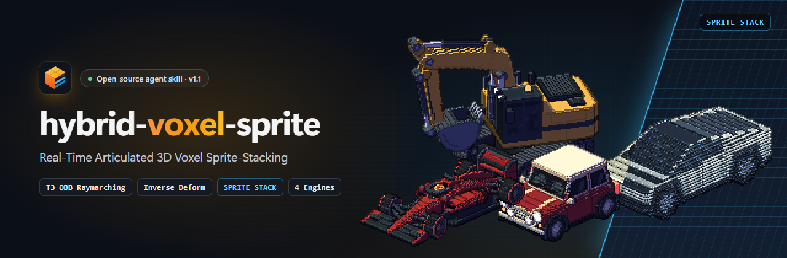
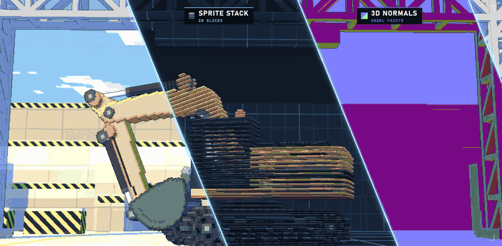
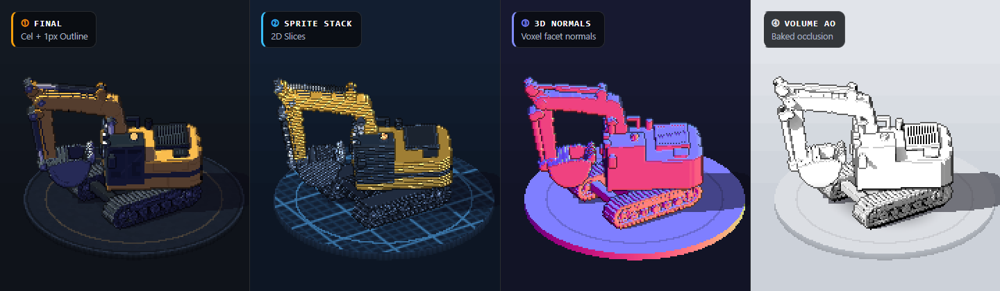
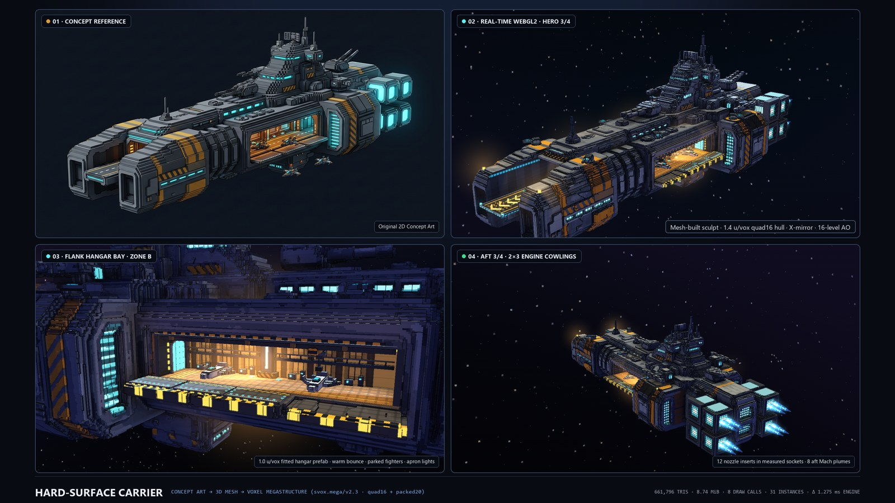
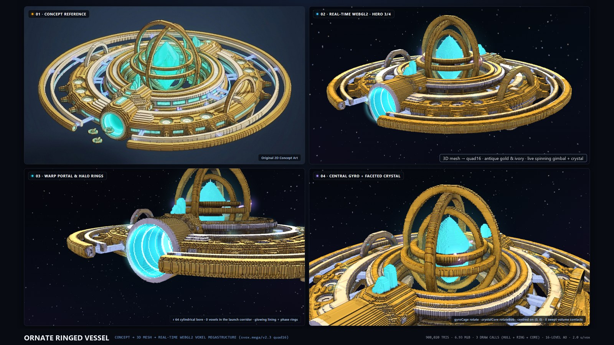
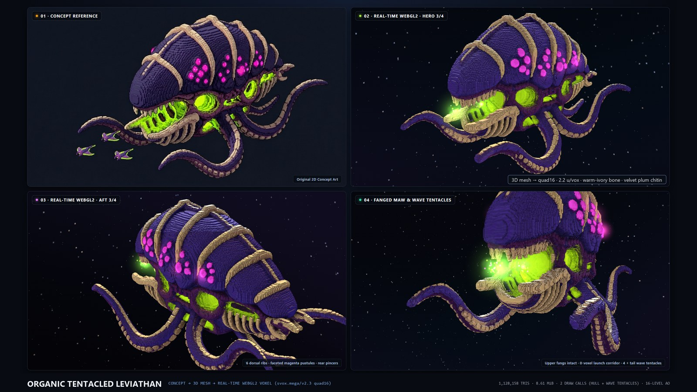
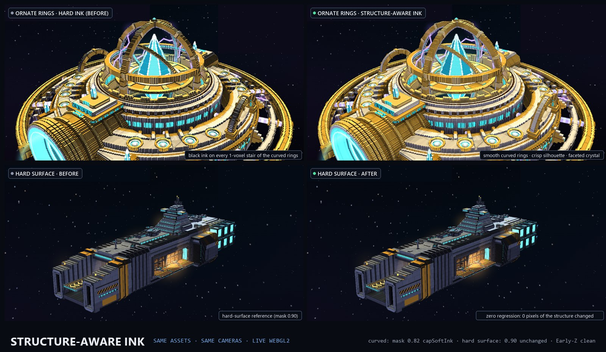

<div align="center">

<a href="https://yskim3271.github.io/hybrid-voxel-sprite/?lang=ko"></a>

<h3>2D 스프라이트 감성. 실시간 3D 볼륨. 틈새 제로.</h3>
<p>4개 게임 엔진에서 실시간 관절형 3D 복셀 스프라이트를 구현하는 에이전트 스킬.</p>

<a href="https://yskim3271.github.io/hybrid-voxel-sprite/?lang=ko"></a>&nbsp;
<a href="#빠른-시작"></a>

<p>
<a href="README.md">English</a> · <b>한국어</b>
<br>
<a href="https://yskim3271.github.io/hybrid-voxel-sprite/?lang=ko">라이브 데모</a> ·
<a href="#실제로-보기">실제로 보기</a> ·
<a href="#v24-mesh-input">메가스트럭처 (v2.4)</a> ·
<a href="#4개-엔진에서-검증">엔진</a> ·
<a href="#빠른-시작">빠른 시작</a> ·
<a href="#cli">CLI</a> ·
<a href="#qa-gates">QA 게이트</a> ·
<a href="https://yskim3271.github.io/hybrid-voxel-sprite/changelog.html?lang=ko">버전 히스토리</a>
</p>

</div>

**hybrid-voxel-sprite는 코딩 에이전트에게 틈이 생기지 않는 스프라이트 스태킹 캐릭터·차량을 만드는 전체 레시피를 줍니다.**
모델은 작은 복셀 파츠들로 이루어지고, 파츠마다 자기만의 회전 박스 안에서 레이마칭합니다(**T3 OBB 레이마칭**).
squash·twist·shear·wave 변형은 샘플마다 분석적으로 되돌리고, 결과는 셀 라이팅과 베이크 AO·자기 그림자로 칠한 뒤
가상 픽셀 격자에 스냅하고 1 px 외곽선을 두릅니다. 표준 라이브러리만 쓰는 **SVOX 에셋 CLI**와
**WebGL2 / Three.js, Godot 4, Unity 6 URP, Blender 5** 어댑터를 함께 제공하며, 모두 같은 4대 QA 게이트로 검증했습니다.
**Track B로 대형 메가스트럭처(~500–1500 u)**도 다룹니다. 미리 베이크한 멀티 스케일 그리디 메시를 `quad16`(쿼드당 16 B)으로
패킹하고, 확장 가능한 머티리얼 프리셋과 콘셉트 비교(G5) · 성능(G6) 게이트로 검증합니다. Track B의 외형은 정사영 3-뷰만으로
완전히 오프라인에서 만들 수도 있고(**모드 B1**, 기본값), 원할 때는 원하는 방법으로 구한 3D `.glb` / `.gltf` 모델에서 만들 수도
있습니다(**모드 B2**).

## 실제로 보기

<div align="center">

<a href="https://yskim3271.github.io/hybrid-voxel-sprite/?lang=ko"></a>

<sub>관절형 차량 4대 · 39 파츠 · 166,290 복셀 · 실시간 Three.js r187 + T3. 사선 띠마다 같은 프레임의 다른 라이브 뷰가 드러납니다.</sub>



<sub>같은 포즈, 네 가지 라이브 모드: <b>FINAL</b>(셀 셰이딩 + 1px 외곽선) · <b>SPRITE STACK</b>(2D 슬라이스 카드) · <b>3D NORMALS</b> · <b>VOLUME AO</b></sub>

**[▶ 라이브 WebGL2 데모 열기](https://yskim3271.github.io/hybrid-voxel-sprite/?lang=ko)**: 360° 궤도 회전, 피치 8°–68°, 차량·클립·렌더 모드 전환.

</div>

<a id="v24-mesh-input"></a>
## Track B · 대형 메가스트럭처 (v2.4)

Track B는 약 500–1500 u 크기의 대형 복셀 구조물(성채, 기지, 대형 함체, 거대 개체 등)을 **`svox.mega/v2.3`**(`quad16` 16 B/quad 매크로 + 인스턴스 `packed20` 메소 프리팹 + 프로시저럴 마이크로 셰이더, 12 MiB / 16 드로우 / 1.2M 삼각형 예산 · 16단계 듀얼 AO)으로 처리합니다.

**v2.4 주요 업데이트**
- **사용자가 고르는 Track B 두 모드**: **모드 B1** *(기본값)*은 정사영 3-뷰 비주얼 헐 카빙으로 100% 오프라인을 유지하고, **모드 B2** *(선택)*는 유기체·장식·깊은 조형에 맞게 `.glb` / `.gltf`를 복셀화합니다. 스킬은 3D 입력을 가정하지 않고 어느 모드를 쓸지 먼저 묻습니다.
- **교체 가능한 모델 공급자** (`mesh_source.mjs`): `local` 파일 *(기본값)*, `command` *(셸 없이 실행하는 임의 CLI · 로컬 오픈소스 모델)*, `manual` 웹 UI · DCC 수동 전달, 선택형 `tripo` API 어댑터, 그 밖의 서비스는 `registerProvider()`로 확장합니다. 검증·SHA-256 캐시·비밀 값 마스킹을 기본 제공합니다.
- **메시→복셀 엔진** (`mesh_to_voxel.mjs`): CPU 6-뷰 정렬 시트, 보수적 복셀화, 내부 채움, 좌우 대칭, 팔레트·발광 규칙, 디테일 존 카빙, 통합 16단계 AO 1회 굽기와 wave 자동 앵커를 갖춘 다중 파트 분할.
- **구조 인식 셰이더**: 곡면·유기체에서 1-복셀 계단마다 생기던 검은 선을 없애면서 1 px 외곽 실루엣과 실제 단차는 유지합니다(하드서피스 변화 `0 px`). 클리핑 없는 발광으로 수정 면과 발광 구체 음영을 살리고, 뿌리 이음매 이동 `0 px`인 앵커 wave 모드(`'box'` / `'ellipsoid'`)를 지원하며 Early-Z를 그대로 유지합니다.
- **검증**: `test_mesh_harness.mjs` **32/32** (합성 `.glb`, 네트워크 호출 0) · `test_mega_kit.mjs` **78/78** · Python 스위트 **26 통과 / 0 실패**.

**적용 예시 (패널 01 = 2D 콘셉트 아트 · 패널 02–04 = 실시간 WebGL2, 모드 B2로 제작):**

<div align="center">

<a href="docs/assets/v24/hard_surface_carrier_v24.jpg"></a>

<sub><b>하드서피스 캐리어</b> · 삼각형 662k · 8.74 MiB · 드로우 8 · 인스턴스 프리팹 31개</sub>

<a href="docs/assets/v24/ornate_ringed_vessel_v24.jpg"></a>
<a href="docs/assets/v24/organic_leviathan_v24.jpg"></a>

<sub><b>금·상아 링형 구조물</b> · 삼각형 908k · 6.93 MiB · 드로우 3 (회전 링 + 코어) &nbsp;|&nbsp; <b>유기체 거대 개체</b> · 삼각형 1.13M · 8.61 MiB · 드로우 2 (wave 촉수)</sub>

<a href="docs/assets/v24/structure_aware_ink_v24.jpg"></a>

<sub><b>구조 인식 잉크</b> · 같은 에셋, 같은 카메라: 곡면 링의 계단 잉크는 사라지고 하드서피스 구조물은 그대로입니다</sub>

</div>

**[전체 버전 히스토리 (v2.4 · v2.3 · v2.2 · v2.0 · v1.x) →](https://yskim3271.github.io/hybrid-voxel-sprite/changelog.html?lang=ko)**

## 빠른 시작

**모든 에이전트** (Claude Code, Antigravity, Codex, Cursor 등)

```bash
npx skills add yskim3271/hybrid-voxel-sprite
```

**Claude Code 플러그인 마켓플레이스**

```text
/plugin marketplace add yskim3271/hybrid-voxel-sprite
/plugin install hybrid-voxel-sprite
```

<details>
<summary><b>수동 설치</b></summary>

`skills/hybrid-voxel-sprite/` 폴더를 사용하는 에이전트의 스킬 디렉터리에 복사합니다.

| 에이전트 | 설치 경로 |
|---|---|
| Claude Code | `~/.claude/skills/hybrid-voxel-sprite` |
| Antigravity (`agy`) | `~/.gemini/config/skills/hybrid-voxel-sprite` |
| Codex / Open Agents | `~/.agents/skills/hybrid-voxel-sprite` |
| Cursor 등 기타 | 각 도구의 skills 디렉터리 (`SKILL.md` 프론트매터 표준) |

```bash
git clone https://github.com/yskim3271/hybrid-voxel-sprite
cp -r hybrid-voxel-sprite/skills/hybrid-voxel-sprite ~/.claude/skills/
```

</details>

설치한 뒤에는 이렇게 말하면 됩니다: *"hybrid-voxel-sprite 스킬로 귀에 스프링이 달린 Three.js 복셀 고양이를 만들고 4대 QA 게이트까지 통과시켜줘."*

## 4개 엔진에서 검증

<table align="center">
  <tr>
    <td align="center" width="200"><a href="skills/hybrid-voxel-sprite/references/targets/webgl2_threejs.md"><br><b>WebGL2 / Three.js</b></a><br><sub>r187 · v1.1 3D 월드 MRT 포함</sub></td>
    <td align="center" width="200"><a href="skills/hybrid-voxel-sprite/references/targets/godot4.md"><br><b>Godot 4.7.2</b></a><br><sub>Forward+ · Mobile (Vulkan)</sub></td>
    <td align="center" width="200"><a href="skills/hybrid-voxel-sprite/references/targets/unity_urp.md"><br><b>Unity 6 URP</b></a><br><sub>RenderGraph · D3D11 / D3D12</sub></td>
    <td align="center" width="200"><a href="skills/hybrid-voxel-sprite/references/targets/blender_exporter.md"><br><b>Blender 5.3.0</b></a><br><sub>SVOX 에셋 추출 브리지</sub></td>
  </tr>
  <tr>
    <td align="center">✅ G1–G4 통과</td><td align="center">✅ G1–G4 통과</td><td align="center">✅ G1–G4 통과</td><td align="center">✅ G1–G4 통과</td>
  </tr>
</table>

<p align="center"><b>함께 쓰는 에이전트</b> Claude Code · Antigravity · Codex · Cursor</p>

## 할 수 있는 일

| 하고 싶은 것 | hybrid-voxel-sprite가 주는 것 |
|---|---|
| 낮은 카메라 각도에서도 틈 없는 스프라이트 스태킹 | 파츠별 OBB DDA로 실제 3D 볼륨을 레이마칭: 14°에서 균열 텍셀 0 (G1) |
| 반짝이지 않는 선명한 픽셀아트 | 카메라와 루트를 가상 FBO 텍셀 격자에 스냅: 크롤 0 px (G2) |
| 스키닝 없이 찌그러짐·비틀림·출렁임 | 샘플마다 분석적 역변형 + 스프링 2차 모션, 오차 1.8e-15 (G3) |
| MagicaVoxel이나 슬라이스 스트립에서 에셋 만들기 | `svox_cli.py`: `.vox`·스트립 가져오기, 노멀 + AO 베이크, 리그 검증, 아틀라스 패킹 |
| 내 엔진에서도 같은 룩 | WebGL2 / Three.js, Godot 4, Unity 6 URP 어댑터와 Blender 익스포트 브리지 |
| 빛나는 헤드라이트·경광등·테일램프 | 스크린 공간 글로우 헤일로가 있는 6-슬롯 이미시브 팔레트 |
| 10–40 파츠 리그에서도 Z-파이팅 없음 | D24 깊이 버킷 타이브레이크: 그리는 순서를 뒤집어도 0 px |
| 완전한 3D 월드 안의 복셀 액터 | 깊이 버퍼 하나를 공유하는 PerspectiveCamera MRT 하이브리드, 액터 마스크 포스트 FX |
| 원리를 보여 주기 | 볼륨을 실시간으로 2D 슬라이스 카드로 나눠 보여 주는 라이브 `SPRITE STACK` 모드 |
| 콘셉트 아트로 대형(~500–1500 u) 복셀 구조물 만들기 | Track B: 3-뷰 비주얼 헐, `detail_zones.json` 콜아웃, 매크로/메소/마이크로 그리디 메시와 인스턴스 프리팹, 듀얼 스케일 AO |
| 용량 예산 안에서 곡면·유기체 대형 구조물 | `quad16`: 쿼드당 16 B, 인덱스 버퍼 없음, 12 MiB 예산. 메소 프리팹은 `packed20`(정점당 20 B) |
| 결과물이 콘셉트와 맞는다는 증거 | G5 멀티 큐(실루엣 IoU + 엣지 F1 + 사용자 정의 강조색 밴드)와 촉수형 에셋용 선체 전용 IoU, G6 드로우·삼각형·용량·ms 예산 |

<a id="cli"></a>
<details>
<summary><b>SVOX CLI</b> (Python 3.8+, 표준 라이브러리만 사용)</summary>

```bash
cd skills/hybrid-voxel-sprite
# 3-파츠 레퍼런스 번들 (+ sample_cube.vox), 베이크 완료 상태
python scripts/svox_cli.py init-demo --out build/demo
# MagicaVoxel .vox (멀티 모델 씬 그래프는 shape 노드마다 파츠 하나로 분리)
python scripts/svox_cli.py from-vox --input hero.vox --out build/hero --bake
# 가로 슬라이스 스트립 PNG (w = X*Z, h = Y) → 파츠 하나
python scripts/svox_cli.py from-strip --input cape.png --size-x 12 --size-y 4 --size-z 16 --part-name cape --out build/hero
# 3x3x3 Sobel 노멀 + 전방 반구 AO + 1-복셀 셸 팽창
python scripts/svox_cli.py bake-normal-ao --bundle build/hero
# 스키마, 얇은 파츠, 지면 접촉, 루프 이음매, undeform(deform(p)) < 1e-5
python scripts/svox_cli.py validate --bundle build/hero --output build/hero_report.json
# 엔진 패킹: strip_x PNG | grid_2d 플립북 PNG | raw_3d RGBA8 .bin (+ manifest.json)
python scripts/svox_cli.py pack-atlas --bundle build/hero --format raw_3d --out build/hero_raw3d
```

</details>

<details>
<summary><b>메가스트럭처 키트</b> (Node ≥ 18, npm 의존성 없음)</summary>

`mega_voxel_kit.mjs`는 비주얼 헐, 디테일 존, 매크로 캐비티 AO, 그리디 메싱, `svox.mega` 패커, CPU 프리뷰를 담은
라이브러리 겸 CLI입니다. `mega_diff_utils.mjs`에는 PNG 코덱, 실루엣 IoU, 멀티 큐 / 선체 전용 G5, 비교 시트가 있습니다.
둘 다 import 가능한 ES 모듈이며, 오류나 목표 미달이면 종료 코드 1을 반환합니다.

```bash
cd skills/hybrid-voxel-sprite
node scripts/test_mega_kit.mjs                                      # 자체 테스트: 78개 검사
# 디테일 존: 아키타입 템플릿 (generic_megastructure | hard_surface_carrier | halo_mothership | bio_leviathan)
node scripts/mega_voxel_kit.mjs zones-template --archetype generic_megastructure --asset structure_01 --hull-size 400,900,300 --out build/s/detail_zones.json
# 블루프린트 PNG → 비주얼 헐 → 존 카빙 → 매크로 AO → 그리디 메시 → .json + .bin
node scripts/mega_voxel_kit.mjs hull --top bp_top.png --side bp_side.png --front bp_front.png --length-y 1019 \
    --voxel-scale 3.5 --zones build/v/detail_zones.json --out build/v/hull
node scripts/mega_voxel_kit.mjs inspect --asset build/v/hull.json   # 통계 + 정적 G6 검사
node scripts/mega_voxel_kit.mjs demo --v23 --out build/mega_demo23  # svox.mega/v2.3 quad16 매크로 + packed20 메소: 56 KiB
# G5: 실루엣 IoU · v2.2 멀티 큐 · v2.3 선체 전용
node scripts/mega_diff_utils.mjs iou --ref concept_34.png --render render_34.png --target 0.78 --diff qa/hero_diff.png
node scripts/mega_diff_utils.mjs multicue --ref concept_34.png --render render_34.png --kind hero --out qa/g5_multicue.png
node scripts/mega_diff_utils.mjs hull --ref side.png --render side_render.png --ref-hull side_hull.png --render-hull side_render_nowave.png --target 0.86
```

**모드 B2 (선택형 3D 메시 입력).** 모델 공급자를 고른 뒤 복셀화합니다:

```bash
node scripts/test_mesh_harness.mjs                                  # 자체 테스트: 32개 검사, 네트워크 호출 0
node scripts/mesh_source.mjs list-providers                         # local · command · manual · tripo (+ 직접 등록한 공급자)
node scripts/mesh_source.mjs acquire --provider local --glb exports/vessel.glb --out build/vessel/mesh
node scripts/mesh_source.mjs acquire --provider command --image concept_clean.png --out build/vessel/mesh \
    --cmd "my-image-to-3d --input {image} --output {out}"
node scripts/mesh_to_voxel.mjs inspect --source build/vessel/mesh/mesh_source.json --out build/vessel/inspect --rot-x 90 --length-y 950
node scripts/mesh_to_voxel.mjs voxelize --source build/vessel/mesh/mesh_source.json --out-asset build/vessel/vessel \
    --rot-x 90 --length-y 950 --voxel-scale 2.0 --solidify --symmetrize x:high \
    --split-part "tentacles:wave:z<-60,ax>95:wave=16,0.012,0:axis=box:auto:cc=400"
```

모드 결정표를 포함한 파이프라인 전체는 [04_megastructure_voxel_pipeline.md](skills/hybrid-voxel-sprite/references/04_megastructure_voxel_pipeline.md)에 있습니다.

</details>

<a id="qa-gates"></a>
<details>
<summary><b>4대 필수 QA 게이트</b> (minimal_reference 벤치마크)</summary>

| 게이트 | 통과 기준 | 측정값 (GTX 1080 · SwiftShader) |
|---|---|---|
| **G1** 저각도 14° 무틈 | 슬라이스 균열 텍셀 0 (CPU 재추적, α ≥ 0.75) | 192 렌더 0 균열, 검출기 자가 테스트 6/6 |
| **G2** 서브텍셀 스냅, 크롤 0 px | 반 텍셀 미만 이동 시 스냅 ON 0 px, OFF > 0 px | 0 / 0 / 0 px (OFF 9–21k px) |
| **G3** `undeform(deform(p))` | 최대 오차 < 1e-5 | 1.8e-15 (JS) · 9.9e-16 (`validate`) |
| **G4** 지면 · 루프 · 가림 | 최저점 ±0.5, 루프 이음매 < 1e-3, 역순 렌더 0 px | 최저 z 0.000 · 이음매 2e-15 · 역순 0 px |

프레임 시간: 640×360 ×3 기준 **0.8 ms**(3파츠 레퍼런스), **0.9 ms**(13파츠 기사). GTX 1080에서 1×1 `readPixels`로 프레임을 닫아 측정했습니다.

**솔직한 포지셔닝.** 픽셀 스케일 스프라이트가 화면에 많이 나오는 아이소메트릭·탑다운·사이드뷰 게임에 맞습니다.
저사양 모바일에서 화면을 꽉 채우는 클로즈업에는 맞지 않습니다. 비용은 덮인 가상 픽셀 × 마치 길이에 비례하므로
`pixelScale`을 올리거나 화면상 크기를 제한하세요.

**메가스트럭처 게이트 (Track B, 에셋마다 엔진 안에서 측정).**

| 게이트 | 통과 기준 | 레퍼런스 구조물 측정값 |
|---|---|---|
| **G5** 콘셉트 비교 | 실루엣 IoU 히어로 ≥ 0.78 / 정사영 ≥ 0.85 · 엣지 F1 히어로 ≥ 0.52 / 정사영 평균 ≥ 0.55 · 사용자 정의 강조색 밴드 0.5–2.0 · 촉수형은 **선체 전용 IoU ≥ 0.86** | 하드서피스 정사영 엣지 F1 0.560 · 링형 히어로 IoU 0.880 / 엣지 F1 0.674 · 유기체 선체 IoU 0.880 / 0.925 / 0.934 |
| **G6** 메가스트럭처 성능 | `MEGA_V23_BUDGET`: `.bin` ≤ 12 MiB · 드로우 ≤ 16 · 삼각형 ≤ 1.2M · Δ ≤ 2.5 ms · Early-Z 유지 | 6.02–8.93 MiB · 드로우 5–10 · 삼각형 410k–1.11M · 0.3–0.8 ms |

</details>

<details>
<summary><b>버전 히스토리 하이라이트</b> (v2.4 · v2.3 · v2.2 · v2.0 · v1.1)</summary>

**v2.4.0 · 2026-11-28.** Track B 모드 선택(기본값 B1 오프라인 3-뷰 헐, 선택형 B2 3D 메시 입력), 교체 가능한 모델 공급자
(`local`, `command`, `manual`, 선택형 `tripo`, `registerProvider`), 다중 파트 분할과 통합 AO 1회 굽기를 갖춘 메시→복셀 변환,
구조 인식 잉크, 클리핑 없는 발광, 앵커 wave, 메시 자체 테스트 `32/32`.

**v2.3.0 · 2026-11-28 · 체크포인트.** `svox.mega/v2.3` `quad16` 인스턴스 쿼드(쿼드당 16 B, 인덱스 버퍼 없음, 65,535 정점 상한 없음),
`MEGA_V23_BUDGET`(12 MiB · 드로우 16 · 삼각형 1.2M · Δ 2.5 ms), 확장 가능한 `MATERIAL_PRESETS`, `generic_megastructure`
아키타입, 사용자 정의 `--bands` G5, 선체 전용 G5, Track A/B 스킬 재구성, 키트 자체 테스트 `78/78`.

**v2.2.0 · 2026-11-27.** `svox.mega/v2.2` `packed20`(정점당 20 B, Uint16 인덱스, 2.4배 밀도), 멀티 큐 G5(실루엣 IoU + 내부
엣지 F1 / 챔퍼 + 강조색 밴드), 실시간 엔진 스튜디오 프리뷰 기반 클레이→룩데브 4단계 루프, 70/30 비주얼 레스트 하드서피스 셰이더.

**v2.0.0 · 2026-11-26.** 메가스트럭처 트랙(~500–1500 u): 3-뷰 비주얼 헐 + 가려진 영역 `detail_zones.json` 콜아웃,
매크로/메소/마이크로 그리디 메시와 인스턴스 프리팹, 듀얼 스케일 AO, 의존성 없는 Node 키트, G5 · G6 게이트.

**v1.1.0 · 2026-11-26.** 사신 4종(119,391 복셀), 관절형 차량 4대(39 파츠, 166,290 복셀), 실시간 3D 월드 쇼케이스에서 검증했습니다.

1. **3-뷰 턴어라운드 + 다회차 비주얼 디프 루프**: FRONT · 3/4 · SIDE 레퍼런스에 맞춰 렌더↔비교를 4–12회 반복합니다. 블라인드 절차적 조각은 납작하고 장난감처럼 나옵니다.
2. **멀티 클립 프레이밍**: 휴지 포즈와 모든 클립 12샘플의 합집합으로 카메라를 잡아, 붐·점프·드리프트가 화면 밖으로 잘리지 않습니다.
3. **6-슬롯 이미시브** (`emissiveColors[]`, `emissiveStrength`, 파츠별 `emissive`): 그림자를 우회하는 발광, MRT 알파 인코딩, 스크린 공간 글로우 헤일로.
4. **D24 깊이 버킷 타이브레이크** (`uDepthSlot / uDepthSlots`): 단순 엡실론 바이어스는 1,536-포즈 스윕에서 40회 실패했고, 버킷 방식은 0 px입니다.
5. **하드서피스 리깅**: 매 프레임 서로의 핀을 조준하는 6파츠 텔레스코픽 유압 실린더, 서스펜션과 분리된 `T(hub)·Rz(steer)·Rx(spin)` 휠.
6. **PerspectiveCamera 3D 월드 MRT 하이브리드**: Three.js 월드 메시와 T3 파츠가 깊이 버퍼 하나를 공유하고, 액터 마스크(`C1.a ≥ 0.9`) 덕분에 시네마 포스트 FX는 배경에만 걸립니다.
7. **라이브 `SPRITE STACK` 모드**: `marchStack()`이 DDA 셀과 수평 스프라이트 카드 슬랩을 교차시켜 실제 공기 틈이 보이게 그립니다. 얇은 디테일 구제와 블루프린트 배경 포함.

새 함정 5가지와 확장 검증 레시피는 [03_pitfalls_and_qa_gates.md](skills/hybrid-voxel-sprite/references/03_pitfalls_and_qa_gates.md)에 있습니다.

그림과 함께 정리한 전체 릴리스 노트: **[버전 히스토리](https://yskim3271.github.io/hybrid-voxel-sprite/changelog.html?lang=ko)**

</details>

<details>
<summary><b>저장소 구조</b></summary>

```text
hybrid-voxel-sprite/
├── .claude-plugin/               # Claude Code 플러그인 · 마켓플레이스 매니페스트
├── docs/                         # GitHub Pages 사이트: 라이브 WebGL2 데모, README 에셋
│   ├── index.html · changelog.html · styles.css · site.js
│   ├── demo/                     # T3 렌더러, SPRITE STACK 셰이더, 모션 플러그인, SVOX 번들 4종, 내장 three.js
│   └── assets/                   # 배너 · showcase_loop.gif · modes_compare · CTA 버튼 · 엔진 아이콘
│       ├── v23/                  # v2.3 콘셉트 → 실시간 WebGL2 2×2 시트 (1600×900 JPEG)
│       └── v24/                  # v2.4 메시 기반 예시 + 구조 인식 잉크 비교 (JPEG)
├── skills/hybrid-voxel-sprite/   # ← 스킬 본체 (이 폴더만 설치하면 됨)
│   ├── SKILL.md                  # 개요 · 라우팅 · 워크플로 · CLI · 주요 함정 · QA 게이트 G1–G6
│   ├── scripts/svox_cli.py       # 표준 라이브러리 SVOX 파이프라인 CLI
│   ├── scripts/mega_*.mjs        # 의존성 없는 메가스트럭처 키트 (mega_voxel_kit · mega_diff_utils · test_mega_kit)
│   ├── scripts/mesh_*.mjs        # 모드 B2: mesh_source (모델 공급자) · mesh_to_voxel · test_mesh_harness
│   ├── references/               # 01 계약·수학 · 02 셰이더 파이프라인 · 03 함정·게이트 · 04 메가스트럭처 · targets/
│   └── assets/minimal_reference/ # 3-파츠 레퍼런스 리그 + sample_cube.vox
├── tests/                        # CLI · 베이크 패리티 · validate · pack-atlas · 문서/링크 검사
├── LICENSE · README.md · README.ko.md
```

```bash
SKIP_WEBGL=1 python tests/test_skill_svox.py               # 독립 저장소: 26 통과 · 0 실패 · 4 스킵 (원본 저장소 전용 하네스)
node skills/hybrid-voxel-sprite/scripts/test_mega_kit.mjs    # 메가스트럭처 키트: 78/78 통과 (임시 파일은 os.tmpdir()에만)
node skills/hybrid-voxel-sprite/scripts/test_mesh_harness.mjs   # 모드 B2 메시 도구: 32/32 통과 (네트워크 호출 0)
```

- 노멀/AO 베이크는 원본 JS 코어(`computeNormalAndAO`)와 바이트 단위로 같습니다. 테스트는 기록된 sha256과 비교하고, `SVOX_JS_CORE=<voxel_builder.js>`를 지정하면 Node로 실시간 비교합니다.
- 레퍼런스 문서의 `src/…`, `target_tests/…`, `artifacts/…` 경로는 공개되지 않은 원본 개발 저장소의 위치입니다. 공식과 상수는 모두 문서 안에 들어 있습니다.

</details>

## 라이선스

[MIT](LICENSE) © 2026 Yunsik Kim (yskim3271)
