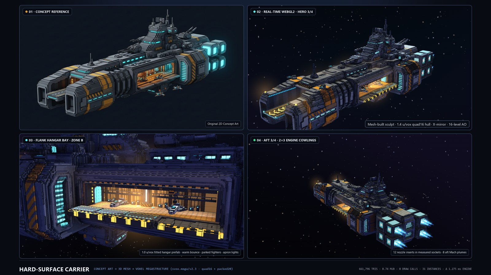
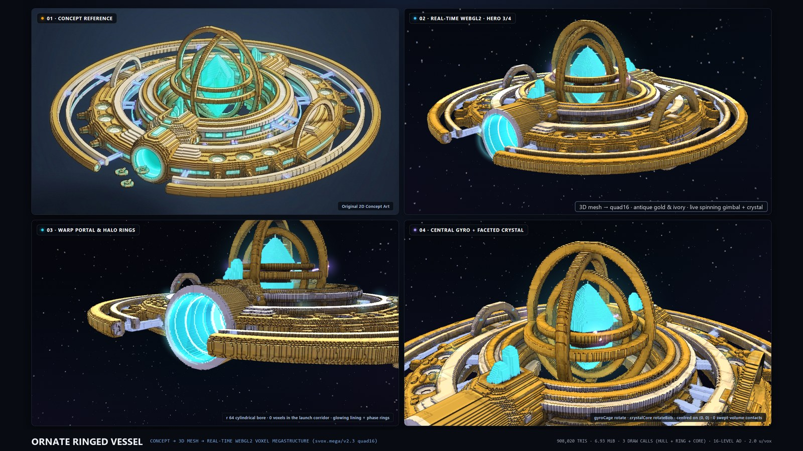
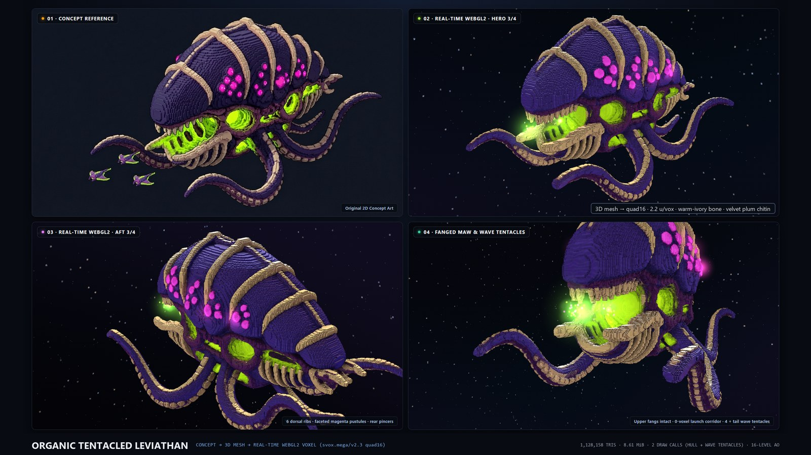

<div align="center">

<a href="https://yskim3271.github.io/hybrid-voxel-sprite/"></a>

<h3>2D sprite charm. Real-time 3D volumes. Zero cracks.</h3>
<p>An open-source agent skill for articulated 3D pixel-art sprites across 4 engines.</p>

<a href="https://yskim3271.github.io/hybrid-voxel-sprite/"></a>&nbsp;
<a href="#quick-start"></a>

<p>
<b>English</b> · <a href="README.ko.md">한국어</a>
<br>
<a href="https://yskim3271.github.io/hybrid-voxel-sprite/">Live Demo</a> ·
<a href="#see-it-in-action">See it in action</a> ·
<a href="#v24-mesh-input">Megastructures (v2.4)</a> ·
<a href="#verified-across-4-engines">Engines</a> ·
<a href="#quick-start">Quick Start</a> ·
<a href="#cli">CLI</a> ·
<a href="#qa-gates">QA Gates</a> ·
<a href="https://yskim3271.github.io/hybrid-voxel-sprite/changelog.html">Version History</a>
</p>

</div>

**hybrid-voxel-sprite gives your coding agent a complete recipe for sprite-stacked characters and vehicles that never crack.**
Each model is a set of small voxel parts. Every part is raymarched inside its own oriented box (**T3 OBB raymarching**),
squash / twist / shear / wave deformations are undone analytically per sample, and the result is cel-lit with baked AO and
self-shadow, snapped to a virtual pixel grid and outlined at 1 px. The skill ships a standard-library-only **SVOX asset CLI**
and adapters for **WebGL2 / Three.js, Godot 4, Unity 6 URP and Blender 5**, all checked against the same 4 QA gates.
It also includes **Track B for large-scale megastructures (~500–1500 u)**: pre-baked multi-scale greedy meshes packed as
`quad16` (16 B per quad), with extensible material presets and concept-diff (G5) / performance (G6) gates. Track B builds
the envelope fully offline from three orthographic views (**Mode B1**, default) or, when you opt in, from a 3D `.glb` /
`.gltf` model you obtain any way you like (**Mode B2**).

## See it in action

<div align="center">

<a href="https://yskim3271.github.io/hybrid-voxel-sprite/"></a>

<sub>4 articulated vehicles · 39 parts · 166,290 voxels · real-time Three.js r187 + T3. Each diagonal band is a different live view of the same frame.</sub>


<sub>Same pose, four live modes: <b>FINAL</b> (cel + 1px outline) · <b>SPRITE STACK</b> (2D slice cards) · <b>3D NORMALS</b> · <b>VOLUME AO</b></sub>

**[▶ Open the live WebGL2 demo](https://yskim3271.github.io/hybrid-voxel-sprite/)**: orbit 360°, pitch 8°–68°, switch vehicles, clips and render modes.

</div>

<a id="v24-mesh-input"></a>
## Track B · Large-Scale Megastructures (v2.4)

Track B builds ~500–1500 u voxel structures (fortresses, stations, vessels, titans) with **`svox.mega/v2.3`** (`quad16` 16 B/quad macro parts + instanced `packed20` meso prefabs + procedural micro shader, inside a 12 MiB / 16-draw / 1.2M-tri budget with 16-level Dual-Scale AO).

**What's new in v2.4**
- **Two Track B modes, chosen by you**: **Mode B1** *(default)* stays 100 % offline with 3-view visual-hull carving; **Mode B2** *(opt-in)* voxelizes a `.glb` / `.gltf` for organic, ornate or deeply sculpted forms. The skill asks which mode you want instead of assuming 3D input.
- **Pluggable model sources** (`mesh_source.mjs`): `local` file *(default)*, `command` *(any CLI or local open-source model, run without a shell)*, `manual` web-UI / DCC hand-off, an optional `tripo` API adapter, and `registerProvider()` for any custom generator. Validated, SHA-256 cached, secrets redacted.
- **Mesh-to-voxel engine** (`mesh_to_voxel.mjs`): CPU 6-view alignment sheets, conservative voxelization, solidify, symmetry, palette & emissive rules, detail-zone carves, and multi-part splits with one unified AO bake and auto-anchored waves.
- **Structure-aware shaders**: curved and organic forms lose black 1-voxel stair lines while keeping crisp 1 px silhouettes and real creases (`0 px` change on hard-surface assets); non-clipping emissives preserve crystal facets and shaded glow orbs; anchored wave modes (`'box'` / `'ellipsoid'`) keep root seams locked (`0 px` drift) with Early-Z intact.
- **Verification**: `test_mesh_harness.mjs` **32/32** (synthetic `.glb`, 0 network calls) · `test_mega_kit.mjs` **78/78** · Python suite **26 passed / 0 failed**.

**Examples (panel 01 = 2D concept art · panels 02–04 = real-time WebGL2, built through Mode B2):**

<div align="center">

<a href="docs/assets/v24/hard_surface_carrier_v24.jpg"></a>

<sub><b>Hard-surface carrier</b> · 662k tris · 8.74 MiB · 8 draws · 31 instanced prefabs</sub>

<a href="docs/assets/v24/ornate_ringed_vessel_v24.jpg"></a>
<a href="docs/assets/v24/organic_leviathan_v24.jpg"></a>

<sub><b>Ornate ringed vessel</b> · 908k tris · 6.93 MiB · 3 draws (spinning ring + core) &nbsp;|&nbsp; <b>Organic leviathan</b> · 1.13M tris · 8.61 MiB · 2 draws (wave tentacles)</sub>

<a href="docs/assets/v24/structure_aware_ink_v24.jpg"></a>

<sub><b>Structure-aware ink</b> · same assets, same cameras: curved rings lose the stair-step ink, the hard-surface structure is unchanged</sub>

</div>

**[Full Version History (v2.4 · v2.3 · v2.2 · v2.0 · v1.x) →](https://yskim3271.github.io/hybrid-voxel-sprite/changelog.html)**

## Quick Start

**Any agent** (Claude Code, Antigravity, Codex, Cursor, …)

```bash
npx skills add yskim3271/hybrid-voxel-sprite
```

**Claude Code plugin marketplace**

```text
/plugin marketplace add yskim3271/hybrid-voxel-sprite
/plugin install hybrid-voxel-sprite
```

<details>
<summary><b>Manual install</b></summary>

Copy `skills/hybrid-voxel-sprite/` into your agent's skills folder.

| Agent | Path |
|---|---|
| Claude Code | `~/.claude/skills/hybrid-voxel-sprite` |
| Antigravity (`agy`) | `~/.gemini/config/skills/hybrid-voxel-sprite` |
| Codex / Open Agents | `~/.agents/skills/hybrid-voxel-sprite` |
| Cursor and others | the tool's skills folder (standard `SKILL.md` front matter) |

```bash
git clone https://github.com/yskim3271/hybrid-voxel-sprite
cp -r hybrid-voxel-sprite/skills/hybrid-voxel-sprite ~/.claude/skills/
```

</details>

Then just ask: *"Use hybrid-voxel-sprite to build a Three.js voxel cat with spring ears and pass the 4 QA gates."*

## Verified across 4 engines

<table align="center">
  <tr>
    <td align="center" width="200"><a href="skills/hybrid-voxel-sprite/references/targets/webgl2_threejs.md"><br><b>WebGL2 / Three.js</b></a><br><sub>r187 · + v1.1 3D-world MRT</sub></td>
    <td align="center" width="200"><a href="skills/hybrid-voxel-sprite/references/targets/godot4.md"><br><b>Godot 4.7.2</b></a><br><sub>Forward+ · Mobile (Vulkan)</sub></td>
    <td align="center" width="200"><a href="skills/hybrid-voxel-sprite/references/targets/unity_urp.md"><br><b>Unity 6 URP</b></a><br><sub>RenderGraph · D3D11 / D3D12</sub></td>
    <td align="center" width="200"><a href="skills/hybrid-voxel-sprite/references/targets/blender_exporter.md"><br><b>Blender 5.3.0</b></a><br><sub>SVOX asset-extraction bridge</sub></td>
  </tr>
  <tr>
    <td align="center">✅ G1–G4 pass</td><td align="center">✅ G1–G4 pass</td><td align="center">✅ G1–G4 pass</td><td align="center">✅ G1–G4 pass</td>
  </tr>
</table>

<p align="center"><b>Works with</b> Claude Code · Antigravity · Codex · Cursor</p>

## What you can do

| Your goal | What hybrid-voxel-sprite provides |
|---|---|
| Sprite stacking without gaps at low camera angles | Per-part OBB DDA raymarching of real 3D volumes: 0 crack texels at 14° (G1) |
| Crisp pixel art that never shimmers | Camera and root snapped to a virtual FBO texel grid: 0 px crawl (G2) |
| Squash, twist, wobble and jiggle without skinning | Analytic inverse deform per sample plus spring secondary motion, error 1.8e-15 (G3) |
| Assets from MagicaVoxel or slice strips | `svox_cli.py`: `.vox` / strip import, normal + AO bake, rig validation, atlas packing |
| The same look in your engine | Step-by-step adapters for WebGL2 / Three.js, Godot 4, Unity 6 URP and a Blender export bridge |
| Headlights, beacons and tail lights that glow | 6-slot emissive palette with a screen-space glow halo |
| 10–40-part rigs that never z-fight | D24 depth-bucket tie-break: reversing draw order changes 0 px |
| Voxel actors inside a full 3D world | PerspectiveCamera MRT hybrid with one shared depth buffer and actor-masked post FX |
| Showing how it works | Live `SPRITE STACK` mode that splits the volume into 2D slice cards in real time |
| Large ~500–1500 u voxel structures from concept art | Track B: 3-view visual hull, `detail_zones.json` callouts, macro / meso / micro greedy meshes with instanced prefabs, dual-scale AO |
| Curved, organic large structures inside a byte budget | `quad16`: 16 B per quad, no index buffer, 12 MiB budget; `packed20` (20 B/vert) for meso prefabs |
| Proof that the build matches the concept | G5 Multi-Cue (silhouette IoU + Edge F1 + configurable accent bands) and Hull-Only IoU for tentacled shapes; G6 draw / triangle / byte / ms budget |

<a id="cli"></a>
<details>
<summary><b>SVOX CLI</b> (Python 3.8+, standard library only)</summary>

```bash
cd skills/hybrid-voxel-sprite
# 3-part reference bundle (+ sample_cube.vox), already baked
python scripts/svox_cli.py init-demo --out build/demo
# MagicaVoxel .vox (a multi-model scene graph becomes one part per shape node)
python scripts/svox_cli.py from-vox --input hero.vox --out build/hero --bake
# horizontal slice-strip PNG (w = X*Z, h = Y) -> one part
python scripts/svox_cli.py from-strip --input cape.png --size-x 12 --size-y 4 --size-z 16 --part-name cape --out build/hero
# 3x3x3 Sobel normals + front-hemisphere AO + 1-voxel shell dilation
python scripts/svox_cli.py bake-normal-ao --bundle build/hero
# schema, thin parts, ground contact, loop seams, undeform(deform(p)) < 1e-5
python scripts/svox_cli.py validate --bundle build/hero --output build/hero_report.json
# engine packing: strip_x PNG | grid_2d flipbook PNG | raw_3d RGBA8 .bin (+ manifest.json)
python scripts/svox_cli.py pack-atlas --bundle build/hero --format raw_3d --out build/hero_raw3d
```

</details>

<details>
<summary><b>Megastructure kit</b> (Node ≥ 18, zero npm dependencies)</summary>

`mega_voxel_kit.mjs` is the library and CLI for the visual hull, detail zones, macro cavity AO, greedy meshing, the
`svox.mega` packers and a CPU preview. `mega_diff_utils.mjs` holds the PNG codec, Silhouette IoU, Multi-Cue / Hull-Only
G5 and comparison sheets. Both are importable ES modules and exit 1 on errors or a failed target.

```bash
cd skills/hybrid-voxel-sprite
node scripts/test_mega_kit.mjs                                      # self-test: 78 checks
# detail zones: archetype template (generic_megastructure | hard_surface_carrier | halo_mothership | bio_leviathan)
node scripts/mega_voxel_kit.mjs zones-template --archetype generic_megastructure --asset structure_01 --hull-size 400,900,300 --out build/s/detail_zones.json
# blueprint PNGs -> visual hull -> zone carves -> macro AO -> greedy mesh -> .json + .bin
node scripts/mega_voxel_kit.mjs hull --top bp_top.png --side bp_side.png --front bp_front.png --length-y 1019 \
    --voxel-scale 3.5 --zones build/v/detail_zones.json --out build/v/hull
node scripts/mega_voxel_kit.mjs inspect --asset build/v/hull.json   # stats + static G6 checks
node scripts/mega_voxel_kit.mjs demo --v23 --out build/mega_demo23  # svox.mega/v2.3 quad16 macro + packed20 meso: 56 KiB
# G5: silhouette IoU · v2.2 multi-cue · v2.3 hull-only
node scripts/mega_diff_utils.mjs iou --ref concept_34.png --render render_34.png --target 0.78 --diff qa/hero_diff.png
node scripts/mega_diff_utils.mjs multicue --ref concept_34.png --render render_34.png --kind hero --out qa/g5_multicue.png
node scripts/mega_diff_utils.mjs hull --ref side.png --render side_render.png --ref-hull side_hull.png --render-hull side_render_nowave.png --target 0.86
```

**Mode B2 (opt-in 3D mesh input).** Pick a model source, then voxelize it:

```bash
node scripts/test_mesh_harness.mjs                                  # self-test: 32 checks, 0 network calls
node scripts/mesh_source.mjs list-providers                         # local · command · manual · tripo (+ your own)
node scripts/mesh_source.mjs acquire --provider local --glb exports/vessel.glb --out build/vessel/mesh
node scripts/mesh_source.mjs acquire --provider command --image concept_clean.png --out build/vessel/mesh \
    --cmd "my-image-to-3d --input {image} --output {out}"
node scripts/mesh_to_voxel.mjs inspect --source build/vessel/mesh/mesh_source.json --out build/vessel/inspect --rot-x 90 --length-y 950
node scripts/mesh_to_voxel.mjs voxelize --source build/vessel/mesh/mesh_source.json --out-asset build/vessel/vessel \
    --rot-x 90 --length-y 950 --voxel-scale 2.0 --solidify --symmetrize x:high \
    --split-part "tentacles:wave:z<-60,ax>95:wave=16,0.012,0:axis=box:auto:cc=400"
```

The full pipeline, including the mode decision table, is in [04_megastructure_voxel_pipeline.md](skills/hybrid-voxel-sprite/references/04_megastructure_voxel_pipeline.md).

</details>

<a id="qa-gates"></a>
<details>
<summary><b>4 mandatory QA gates</b> (minimal_reference benchmark)</summary>

| Gate | Pass condition | Measured (GTX 1080 · SwiftShader) |
|---|---|---|
| **G1** 14° low pitch, no cracks | 0 slice-crack texels (CPU re-trace, α ≥ 0.75) | 0 cracks in 192 renders, detector self-test 6/6 |
| **G2** sub-texel snap, 0 px crawl | snap on: 0 px for sub-half-texel moves; off: > 0 px | 0 / 0 / 0 px (off: 9–21k px) |
| **G3** `undeform(deform(p))` | max error < 1e-5 | 1.8e-15 (JS) · 9.9e-16 (`validate`) |
| **G4** ground · loop · occlusion | lowest point ±0.5, loop seam < 1e-3, reversed order 0 px | z 0.000 · seam 2e-15 · 0 px |

Frame time at 640×360 ×3: **0.8 ms** (3-part reference) and **0.9 ms** (13-part knight) on a GTX 1080, each frame closed with a 1×1 `readPixels`.

**Honest positioning.** Built for isometric, top-down and side-view games with many pixel-scale sprites on screen.
Full-screen close-ups on low-end mobile are not its strength: cost scales with covered virtual pixels × march length,
so raise `pixelScale` or cap on-screen size.

**Megastructure gates (Track B, per asset, in-engine).**

| Gate | Pass condition | Measured across reference structures |
|---|---|---|
| **G5** Concept Diff | Silhouette IoU ≥ 0.78 hero / ≥ 0.85 ortho · Edge F1 ≥ 0.52 hero / ≥ 0.55 ortho avg · configurable accent bands 0.5–2.0 · **Hull-Only IoU ≥ 0.86** for tentacled shapes | Hard-surface ortho Edge F1 0.560 · Ornate hero IoU 0.880 / Edge F1 0.674 · Organic hull IoU 0.880 / 0.925 / 0.934 |
| **G6** Megastructure Perf | `MEGA_V23_BUDGET`: `.bin` ≤ 12 MiB · ≤ 16 draws · ≤ 1.2M tris · Δ ≤ 2.5 ms · Early-Z intact | 6.02–8.93 MiB · 5–10 draws · 410k–1.11M tris · 0.3–0.8 ms |

</details>

<details>
<summary><b>Version History highlights</b> (v2.4 · v2.3 · v2.2 · v2.0 · v1.1)</summary>

**v2.4.0 · 2026-11-28.** Track B mode choice (B1 offline 3-view hull by default, B2 opt-in 3D mesh input), pluggable model
sources (`local`, `command`, `manual`, optional `tripo`, `registerProvider`), mesh-to-voxel with multi-part splits and one
unified AO, structure-aware ink, non-clipping emissives, anchored waves, `32/32` mesh self-test.

**v2.3.0 · 2026-11-28 · Checkpoint.** `svox.mega/v2.3` `quad16` instanced quads (16 B/quad, no index buffer, no 65,535-vertex
cap), `MEGA_V23_BUDGET` (12 MiB · 16 draws · 1.2M tris · Δ 2.5 ms), extensible `MATERIAL_PRESETS`, `generic_megastructure`
archetype, configurable `--bands` in G5, Hull-Only G5, Track A/B skill restructure, `78/78` kit self-test.

**v2.2.0 · 2026-11-27.** `svox.mega/v2.2` `packed20` (20 B/vert, Uint16 indices, 2.4× denser), Multi-Cue G5 (silhouette IoU +
internal Edge F1 / chamfer + accent band), 4-pass clay-to-lookdev loop in a real-engine studio preview, 70/30 visual-rest
hard-surface shader.

**v2.0.0 · 2026-11-26.** Megastructure track (~500–1500 u): 3-view visual hull + occluded `detail_zones.json`
callouts, macro / meso / micro greedy meshes with instanced prefabs, dual-scale AO, zero-dependency Node kit, G5 and G6 gates.

**v1.1.0 · 2026-11-26.** Proven on four mythic guardians (119,391 voxels), four articulated vehicles (39 parts, 166,290 voxels) and a real-time 3D-world showcase.

1. **3-view turnaround + multi-round visual diff loop**: render ↔ compare against FRONT · 3/4 · SIDE references 4–12 times. Blind procedural sculpting looks flat and toy-like.
2. **Multi-clip framing**: frame the union of the rest pose and 12 samples of every clip, so booms, jumps and drifts never leave the shot.
3. **6-slot emissive** (`emissiveColors[]`, `emissiveStrength`, per-part `emissive`): shadow-bypassing glow, MRT alpha encoding, screen-space halo.
4. **D24 depth-bucket tie-break** (`uDepthSlot / uDepthSlots`): a plain epsilon bias failed 40 times in a 1,536-pose sweep; buckets give 0 px.
5. **Hard-surface rigging**: 6-part telescopic hydraulic cylinders that aim at each other's pins every frame, `T(hub)·Rz(steer)·Rx(spin)` wheels decoupled from suspension.
6. **PerspectiveCamera 3D-world MRT hybrid**: Three.js world meshes and T3 parts share one depth buffer; an actor mask (`C1.a ≥ 0.9`) keeps cinema post FX on the background only.
7. **Live `SPRITE STACK` mode**: `marchStack()` intersects DDA cells with horizontal sprite-card slabs, so real air gaps show, with thin-detail rescue and a blueprint backdrop.

Five new pitfalls and the extended verification recipe are in [03_pitfalls_and_qa_gates.md](skills/hybrid-voxel-sprite/references/03_pitfalls_and_qa_gates.md).

Every release with illustrated notes: **[Version History](https://yskim3271.github.io/hybrid-voxel-sprite/changelog.html)**.

</details>

<details>
<summary><b>Repository layout</b></summary>

```text
hybrid-voxel-sprite/
├── .claude-plugin/               # Claude Code plugin + marketplace manifests
├── docs/                         # GitHub Pages site: live WebGL2 demo, README assets
│   ├── index.html · changelog.html · styles.css · site.js
│   ├── demo/                     # T3 renderer, SPRITE STACK shaders, motion plugins, 4 SVOX bundles, vendored three.js
│   └── assets/                   # banner · showcase_loop.gif · modes_compare · CTA buttons · engine icons
│       ├── v23/                  # v2.3 concept → real-time WebGL2 2×2 sheets (1600×900 JPEG)
│       └── v24/                  # v2.4 mesh-built examples + structure-aware ink comparison (JPEG)
├── skills/hybrid-voxel-sprite/   # ← the skill (install only this folder)
│   ├── SKILL.md                  # overview · routing · workflow · CLI · top pitfalls · QA gates G1–G6
│   ├── scripts/svox_cli.py       # stdlib SVOX pipeline CLI
│   ├── scripts/mega_*.mjs        # zero-dependency megastructure kit (mega_voxel_kit · mega_diff_utils · test_mega_kit)
│   ├── scripts/mesh_*.mjs        # Mode B2: mesh_source (model providers) · mesh_to_voxel · test_mesh_harness
│   ├── references/               # 01 contract & math · 02 shader pipeline · 03 pitfalls & gates · 04 megastructures · targets/
│   └── assets/minimal_reference/ # 3-part reference rig + sample_cube.vox
├── tests/                        # CLI · bake parity · validate · pack-atlas · doc/link checks
├── LICENSE · README.md · README.ko.md
```

```bash
SKIP_WEBGL=1 python tests/test_skill_svox.py               # standalone repo: 26 passed · 0 failed · 4 skipped (dev-repo-only harness)
node skills/hybrid-voxel-sprite/scripts/test_mega_kit.mjs    # megastructure kit: 78/78 PASS (temp files only in os.tmpdir())
node skills/hybrid-voxel-sprite/scripts/test_mesh_harness.mjs   # Mode B2 mesh tools: 32/32 PASS (0 network calls)
```

- The normal/AO bake is byte-identical to the original JS core (`computeNormalAndAO`); tests compare against recorded sha256 values, or live through Node with `SVOX_JS_CORE=<voxel_builder.js>`.
- `src/…`, `target_tests/…` and `artifacts/…` paths in the references point into the unpublished development repo. Every formula and constant is in the documents themselves.

</details>

## License

[MIT](LICENSE) © 2026 Yunsik Kim (yskim3271)
