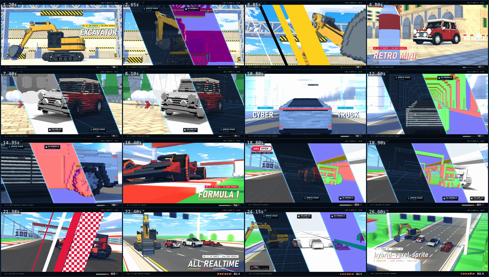
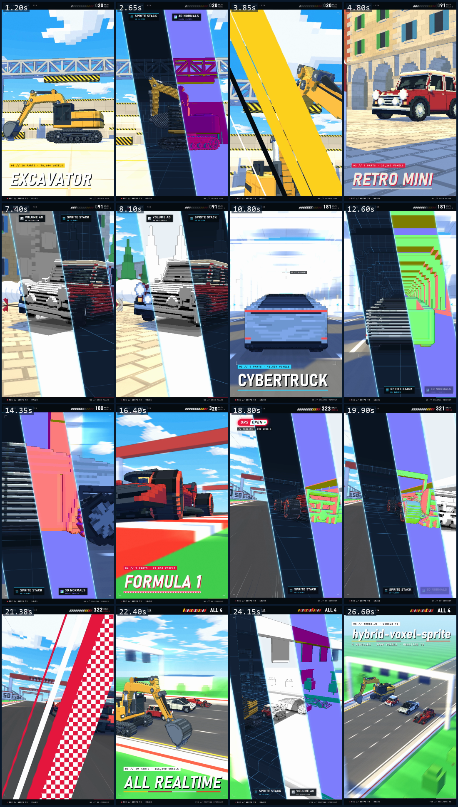

# hybrid-voxel-sprite

    

> **TL;DR (English)**
> An agent skill for building **real-time articulated 3D voxel sprites**: "sprite stacking" that never cracks.
> Each character or vehicle is a set of small voxel parts (`TEXTURE_3D`). Every part is raymarched inside its own
> oriented box (**T3 OBB raymarching**), squash, twist, shear and wave deformations are undone analytically per sample,
> and the result is cel-lit with baked AO and self-shadow, snapped to a virtual pixel grid and outlined at 1 px.
> It ships an engine-neutral, standard-library-only **SVOX asset CLI** (`.vox` and slice-strip import, normal/AO bake,
> rig validation, atlas packing) and adapters for **WebGL2 / Three.js, Godot 4, Unity 6 URP and Blender 5**, each
> verified against the same 4 mandatory QA gates.
> **v1.1** adds 6-slot emissive lights, a D24 depth-bucket tie-break for 10–40-part rigs, a PerspectiveCamera 3D-world
> MRT hybrid mode with actor-masked cinema post-FX, and a live **`SPRITE STACK`** debug view.
> Works with Claude Code, Antigravity (`agy`), Codex / Open Agents and Cursor.

모듈형 복셀 파츠를 파츠별 OBB 3D 볼륨 레이마칭으로 그려서, **슬라이스 틈이 없는 실시간 관절형 3D 픽셀아트 스프라이트**를 만드는
에이전트 스킬입니다. 분석적 역변형(squash·twist·shear·wave), 스프링 2차 모션, 셀 라이팅·AO·자기 그림자, 가상 픽셀 격자 스냅,
1px 외곽선을 다루며, 표준 라이브러리만 쓰는 SVOX 에셋 CLI와 4개 엔진 어댑터를 함께 제공합니다.
`v1.1.0` · Python 3.8+ 표준 라이브러리만 사용 · MIT

---

## 쇼케이스: *Four Worlds* v3 (실시간 Three.js r187 + T3)

> 굴착기·F1·미니·사이버트럭 4대(**39 파츠 · 166,290 복셀**)를 하나의 `PerspectiveCamera`와 하나의 깊이 버퍼로 3D 월드와
> 합성한 60 fps 데이라이트 쇼케이스입니다. 사선 와이프 띠 안은 **SPRITE STACK · 3D NORMALS · VOLUME AO** 뷰가 실시간으로
> 드러납니다. 1,635프레임 무손실 캡처, glError 0, 콘솔·페이지 오류 0.

**16:9 (1920×1080) · 4×4 컨택트 시트**



<details>
<summary><b>9:16 (1080×1920) 세로 컨택트 시트 펼치기</b></summary>



</details>

---

## 왜 T3 하이브리드인가

| 방식 | 문제 | T3 하이브리드의 해법 |
|---|---|---|
| 2D 카드·슬라이스 스태킹 | 14° 이하 저각도에서 층 사이 틈이 보이고, 1복셀 칼날이 회전하면 점선이 됨 | 실제 3D 볼륨을 레이마칭하므로 슬라이스 균열 0 (G1) |
| 매 프레임 재복셀화·키프레임 베이크 | 회전한 얇은 디테일이 계단·뭉개짐, 보간 시 구멍 | 각 파츠의 **원본** 볼륨을 파츠 공간에서 샘플링 → 어떤 회전에도 선명 |
| 스킨드 메시 | UV·리토폴로지·스킨 웨이트 제작 비용 | 강체 파츠 + 피벗 + 파츠당 변형 스칼라 8개, 정확한 역변형 |

모든 히트가 정확한 월드 히트 지점에서 `gl_FragDepth`를 쓰기 때문에 그리기 순서와 무관합니다. 파츠 순서를 뒤집어도 0 px이 바뀝니다.

## v1.1 하이라이트 (실전에서 검증된 7가지 개선)

Four Symbols(사신 4종, 119,391 복셀), 관절형 차량 4대(39 파츠, 166,290 복셀), *Four Worlds* v1–v3 쇼케이스에서 검증했습니다.

1. **3-뷰 턴어라운드 + 다회차 비주얼 디프 루프**: FRONT · 3/4 · SIDE 레퍼런스에 맞춰 렌더↔비교를 4–12회 반복합니다. 블라인드 절차적 조각은 납작하고 장난감처럼 나옵니다.
2. **멀티 클립 프레이밍**: 휴지 포즈 + 모든 클립 12샘플의 합집합으로 카메라를 잡아, 붐·점프·드리프트가 화면 밖으로 잘리지 않습니다.
3. **6-슬롯 이미시브** (`emissiveColors[]`, `emissiveStrength`, 파츠별 `emissive`): 그림자를 우회하는 발광과 MRT 알파 인코딩, 스크린 공간 글로우 헤일로.
4. **D24 깊이 버킷 타이브레이크** (`uDepthSlot / uDepthSlots`): 단순 엡실론 바이어스는 1,536-포즈 스윕에서 40회 실패했고, 버킷 방식은 0 px입니다.
5. **하드서피스 리깅**: 6파츠 텔레스코픽 유압 실린더(배럴·로드가 매 프레임 서로의 핀을 조준), `T(hub)·Rz(steer)·Rx(spin)` 휠을 서스펜션과 분리.
6. **PerspectiveCamera 3D 월드 MRT 하이브리드**: Three.js 월드 메시와 T3 파츠가 하나의 깊이 버퍼를 공유하고, 액터 마스크(`C1.a ≥ 0.9`) 덕분에 줌 블러·RGB 스플릿 같은 시네마 포스트 FX는 배경에만 걸립니다. 트레드밀 월드 래핑과 해석적 박스 태양 그림자도 포함합니다.
7. **라이브 `SPRITE STACK` 모드 (`mode == 2`)**: `marchStack()`이 DDA 셀 구간과 수평 스프라이트 카드 슬랩을 교차시켜 실제 공기 틈이 보이는 스프라이트 스택을 실시간으로 그립니다. 얇은 디테일 구제와 블루프린트 배경이 들어 있습니다.

새 함정 5가지(Three.js `ColorManagement` 감마 워시아웃, 이미시브 기본값 `undefined`, ffmpeg VP8 `apad` 큐 오버플로, 임베디드 브라우저 영상 재생, 블라인드 조각)와 확장 검증 레시피도 [03 문서](skills/hybrid-voxel-sprite/references/03_pitfalls_and_qa_gates.md)에 정리했습니다.

## 4-엔진 검증 매트릭스

| 타깃 | 상태 | 검증 환경 | 결과 |
|---|---|---|---|
| [WebGL2 / Three.js r187](skills/hybrid-voxel-sprite/references/targets/webgl2_threejs.md) | ✅ Verified (+ v1.1 3D 월드 하이브리드) | Chrome ANGLE D3D11 (GTX 1080) · SwiftShader | G1–G4 통과, 원본 WebGL2 렌더러와 뷰당 ≤ 72 px 차이 |
| [Godot 4.7.2](skills/hybrid-voxel-sprite/references/targets/godot4.md) | ✅ Verified | Forward+ · Mobile (Vulkan 1.4) | G1–G4 통과, 두 렌더러 픽셀 동일 |
| [Unity 6 URP](skills/hybrid-voxel-sprite/references/targets/unity_urp.md) | ✅ Verified | 6000.5.3f1, RenderGraph, D3D11 · D3D12 | G1–G4 통과, 0.63–0.75 ms |
| [Blender 5.3.0](skills/hybrid-voxel-sprite/references/targets/blender_exporter.md) | ✅ Verified (에셋 추출 브리지) | `--background --factory-startup` | SVOX 번들 → `validate` 0 오류 → T3 렌더 G1–G4 통과 |

## 4대 필수 QA 게이트 (minimal_reference 벤치마크)

| 게이트 | 통과 기준 | 측정값 (GTX 1080 · SwiftShader) |
|---|---|---|
| **G1** 저각도 14° 무틈 | 슬라이스 균열 텍셀 0 (CPU 재추적, α ≥ 0.75) | 192 렌더 0 균열, 검출기 자가 테스트 6/6 |
| **G2** 서브텍셀 스냅: 0 px 크롤 | 반 텍셀 미만 이동 시 스냅 ON 0 px, OFF > 0 px | 0/0/0 px (OFF 9–21k px) |
| **G3** `undeform(deform(p))` | 최대 오차 < 1e-5 | 1.8e-15 (JS) · 9.9e-16 (`validate`) |
| **G4** 지면·루프·가림 | 최저점 ±0.5, 루프 이음매 < 1e-3, 역순 렌더 0 px | 최저 z 0.000 · 이음매 2e-15 · 역순 0 px |

프레임 시간: 640×360 @×3 기준 **0.8 ms**(3파츠 레퍼런스), **0.9 ms**(13파츠 기사). 측정은 GTX 1080에서 1×1 `readPixels`로 프레임을 닫아서 했습니다.

## 설치

**1줄 설치 (권장)**

```bash
npx skills add yskim3271/hybrid-voxel-sprite
```

**수동 설치**: `skills/hybrid-voxel-sprite/` 폴더를 사용하는 에이전트의 스킬 디렉터리에 복사합니다.

| 에이전트 | 설치 경로 |
|---|---|
| Claude Code | `~/.claude/skills/hybrid-voxel-sprite` |
| Antigravity (`agy`) | `~/.gemini/config/skills/hybrid-voxel-sprite` |
| Codex / Open Agents | `~/.agents/skills/hybrid-voxel-sprite` |
| Cursor 등 기타 | 각 도구의 skills 디렉터리 (`SKILL.md` 프론트매터 표준) |

```bash
git clone https://github.com/yskim3271/hybrid-voxel-sprite
cp -r hybrid-voxel-sprite/skills/hybrid-voxel-sprite ~/.claude/skills/
```

## CLI 빠른 시작 (`scripts/svox_cli.py`)

Python 3 표준 라이브러리만 씁니다. `uv run`과 `python` 둘 다 동작합니다.

```bash
cd skills/hybrid-voxel-sprite
# 3-파츠 레퍼런스 번들 (+ sample_cube.vox), 베이크 완료 상태
python scripts/svox_cli.py init-demo --out build/demo
# MagicaVoxel .vox (멀티 모델 씬 그래프는 shape 노드마다 파츠 하나로 분리)
python scripts/svox_cli.py from-vox --input hero.vox --out build/hero --bake
# 3x3x3 Sobel 노멀 + 전방 반구 AO + 1-복셀 셸 팽창
python scripts/svox_cli.py bake-normal-ao --bundle build/hero
# 스키마, 얇은 파츠, 지면 접촉, 루프 이음매, undeform(deform(p)) < 1e-5
python scripts/svox_cli.py validate --bundle build/hero --output build/hero_report.json
# 엔진 패킹: strip_x PNG | grid_2d 플립북 PNG | raw_3d RGBA8 .bin (+ manifest.json)
python scripts/svox_cli.py pack-atlas --bundle build/hero --format raw_3d --out build/hero_raw3d
```

## 사용 예시 (자연어 트리거)

| 이렇게 말하면 | 하는 일 |
|---|---|
| "hybrid-voxel-sprite 스킬로 Three.js 복셀 고양이(귀·꼬리 스프링 + 4다리 걷기) 만들고 4대 게이트 검증해줘" | 에셋 → 리그 → 2-패스 T3 렌더러 → G1–G4 |
| "Godot 4.7.2 Forward+ 프로젝트에 minimal_reference를 띄워 14° 무틈과 1px 외곽선까지" | Godot 어댑터 적용 |
| "Unity 6 URP RenderGraph 씬에 minimal_reference 띄워줘" | URP `ScriptableRendererFeature` |
| "Blender 5.3에서 3파츠 로봇을 만들어 SVOX 번들로 추출·검증해줘" | Blender 익스포터 → `validate` |
| "차량 4대를 3D 월드에서 달리게 하고 SPRITE STACK 와이프 쇼케이스 만들어줘" | v1.1 Perspective MRT 하이브리드 + 6-슬롯 이미시브 + `mode == 2` |

## 프로젝트 구조

```text
hybrid-voxel-sprite/
├── README.md · LICENSE (MIT) · .gitignore
├── assets/showcase/              # Four Worlds v3 컨택트 시트 (16:9 · 9:16)
├── skills/hybrid-voxel-sprite/   # ← 스킬 본체 (이 폴더만 설치하면 됨)
│   ├── SKILL.md                  # 개요 · 라우팅 표 · 5단계 워크플로 · CLI · 함정 Top 7 · 4대 게이트
│   ├── scripts/svox_cli.py       # 표준 라이브러리 SVOX 파이프라인 CLI
│   ├── references/               # 01 계약·수학 · 02 셰이더 파이프라인 · 03 함정·QA 게이트
│   │   └── targets/              # webgl2_threejs · godot4 · unity_urp · blender_exporter
│   └── assets/minimal_reference/ # 3-파츠 레퍼런스 리그 (torso · 2-복셀 칼날 팔 · 뒤집힌 망토) + sample_cube.vox
└── tests/
    ├── test_skill_svox.py        # CLI · PNG · 베이크 패리티 · validate · pack-atlas · 문서/링크 검사
    └── fixtures/js_core_bake_sha256.json   # 검증된 JS 코어 베이크 출력의 sha256
```

```bash
SKIP_WEBGL=1 python tests/test_skill_svox.py     # 독립 저장소: 26 통과 · 0 실패 · 4 스킵(원본 저장소 전용 하네스)
```

- 노멀/AO 베이크는 원본 저장소의 JS 코어(`computeNormalAndAO`)와 **바이트 단위로 동일**합니다. 여기서는 기록된 sha256과 비교하고, `SVOX_JS_CORE=<voxel_builder.js>`를 지정하면 Node로 실시간 비교합니다.
- `T09_WebGLSmoke`(실제 브라우저 스모크 렌더)는 원본 개발 저장소의 렌더러와 CDP 하네스가 필요하므로 여기서는 건너뜁니다. 원본 저장소에서는 29/29가 통과합니다.
- 레퍼런스 문서에 나오는 `src/…`, `target_tests/…`, `artifacts/…` 경로는 공개되지 않은 원본 개발 저장소의 위치입니다. 공식과 상수는 모두 문서 안에 들어 있습니다.

## 성능에 대한 솔직한 포지셔닝

- **강점**: 아이소메트릭·탑다운·사이드뷰처럼 스프라이트가 픽셀 스케일이고, 많은 캐릭터가 한 화면에 나오는 게임에 잘 맞습니다.
- **약점**: 저사양 모바일에서 화면을 꽉 채우는 클로즈업에는 맞지 않습니다. 비용은 *덮인 가상 픽셀 × 마치 길이*에 비례하므로 `pixelScale`을 올리거나 화면상 크기를 제한하세요.

## License

[MIT](LICENSE) © 2026 Yoonsik Kim (yskim3271)
