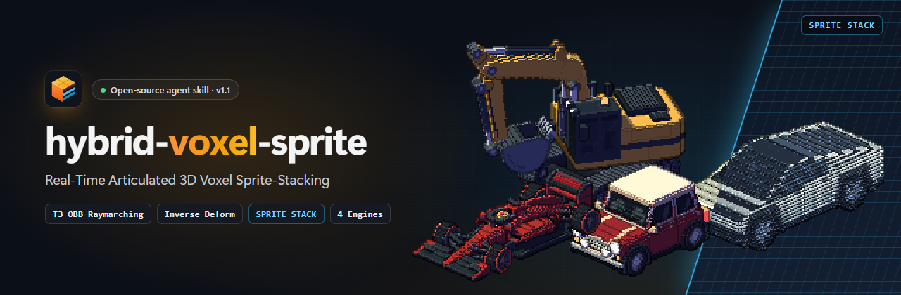
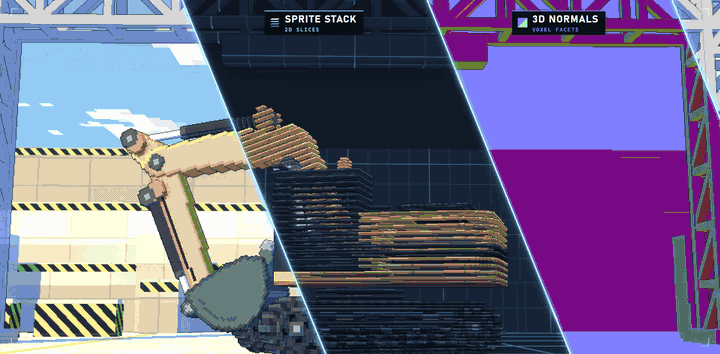
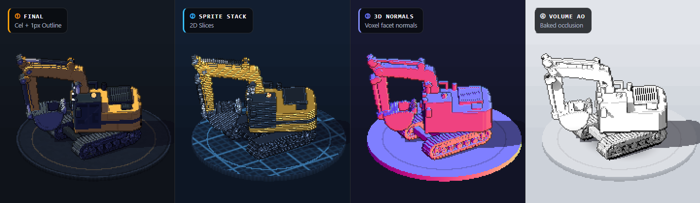

<div align="center">

<a href="https://yskim3271.github.io/hybrid-voxel-sprite/"></a>

<h3>2D sprite charm. Real-time 3D volumes. Zero cracks.</h3>
<p>An open-source agent skill for articulated 3D pixel-art sprites across 4 engines.</p>

<a href="https://yskim3271.github.io/hybrid-voxel-sprite/"></a>&nbsp;
<a href="#quick-start"></a>

<p>
<b>English</b> · <a href="README.ko.md">한국어</a>
<br>
<a href="https://yskim3271.github.io/hybrid-voxel-sprite/">Live Demo</a> ·
<a href="#see-it-in-action">See it in action</a> ·
<a href="#verified-across-4-engines">Engines</a> ·
<a href="#quick-start">Quick Start</a> ·
<a href="#cli">CLI</a> ·
<a href="#qa-gates">QA Gates</a>
</p>

</div>

**hybrid-voxel-sprite gives your coding agent a complete recipe for sprite-stacked characters and vehicles that never crack.**
Each model is a set of small voxel parts. Every part is raymarched inside its own oriented box (**T3 OBB raymarching**),
squash / twist / shear / wave deformations are undone analytically per sample, and the result is cel-lit with baked AO and
self-shadow, snapped to a virtual pixel grid and outlined at 1 px. The skill ships a standard-library-only **SVOX asset CLI**
and adapters for **WebGL2 / Three.js, Godot 4, Unity 6 URP and Blender 5**, all checked against the same 4 QA gates.

## See it in action

<div align="center">

<a href="https://yskim3271.github.io/hybrid-voxel-sprite/"></a>

<sub>4 articulated vehicles · 39 parts · 166,290 voxels · real-time Three.js r187 + T3. Each diagonal band is a different live view of the same frame.</sub>



<sub>Same pose, four live modes: <b>FINAL</b> (cel + 1px outline) · <b>SPRITE STACK</b> (2D slice cards) · <b>3D NORMALS</b> · <b>VOLUME AO</b></sub>

**[▶ Open the live WebGL2 demo](https://yskim3271.github.io/hybrid-voxel-sprite/)**: orbit 360°, pitch 8°–68°, switch vehicles, clips and render modes.

</div>

## Quick Start

**Any agent** (Claude Code, Antigravity, Codex, Cursor, …)

```bash
npx skills add yskim3271/hybrid-voxel-sprite
```

**Claude Code plugin marketplace**

```text
/plugin marketplace add yskim3271/hybrid-voxel-sprite
/plugin install hybrid-voxel-sprite
```

<details>
<summary><b>Manual install</b></summary>

Copy `skills/hybrid-voxel-sprite/` into your agent's skills folder.

| Agent | Path |
|---|---|
| Claude Code | `~/.claude/skills/hybrid-voxel-sprite` |
| Antigravity (`agy`) | `~/.gemini/config/skills/hybrid-voxel-sprite` |
| Codex / Open Agents | `~/.agents/skills/hybrid-voxel-sprite` |
| Cursor and others | the tool's skills folder (standard `SKILL.md` front matter) |

```bash
git clone https://github.com/yskim3271/hybrid-voxel-sprite
cp -r hybrid-voxel-sprite/skills/hybrid-voxel-sprite ~/.claude/skills/
```

</details>

Then just ask: *"Use hybrid-voxel-sprite to build a Three.js voxel cat with spring ears and pass the 4 QA gates."*

## Verified across 4 engines

<table align="center">
  <tr>
    <td align="center" width="200"><a href="skills/hybrid-voxel-sprite/references/targets/webgl2_threejs.md"><br><b>WebGL2 / Three.js</b></a><br><sub>r187 · + v1.1 3D-world MRT</sub></td>
    <td align="center" width="200"><a href="skills/hybrid-voxel-sprite/references/targets/godot4.md"><br><b>Godot 4.7.2</b></a><br><sub>Forward+ · Mobile (Vulkan)</sub></td>
    <td align="center" width="200"><a href="skills/hybrid-voxel-sprite/references/targets/unity_urp.md"><br><b>Unity 6 URP</b></a><br><sub>RenderGraph · D3D11 / D3D12</sub></td>
    <td align="center" width="200"><a href="skills/hybrid-voxel-sprite/references/targets/blender_exporter.md"><br><b>Blender 5.3.0</b></a><br><sub>SVOX asset-extraction bridge</sub></td>
  </tr>
  <tr>
    <td align="center">✅ G1–G4 pass</td><td align="center">✅ G1–G4 pass</td><td align="center">✅ G1–G4 pass</td><td align="center">✅ G1–G4 pass</td>
  </tr>
</table>

<p align="center"><b>Works with</b> Claude Code · Antigravity · Codex · Cursor</p>

## What you can do

| Your goal | What hybrid-voxel-sprite provides |
|---|---|
| Sprite stacking without gaps at low camera angles | Per-part OBB DDA raymarching of real 3D volumes: 0 crack texels at 14° (G1) |
| Crisp pixel art that never shimmers | Camera and root snapped to a virtual FBO texel grid: 0 px crawl (G2) |
| Squash, twist, wobble and jiggle without skinning | Analytic inverse deform per sample plus spring secondary motion, error 1.8e-15 (G3) |
| Assets from MagicaVoxel or slice strips | `svox_cli.py`: `.vox` / strip import, normal + AO bake, rig validation, atlas packing |
| The same look in your engine | Step-by-step adapters for WebGL2 / Three.js, Godot 4, Unity 6 URP and a Blender export bridge |
| Headlights, beacons and tail lights that glow | 6-slot emissive palette with a screen-space glow halo |
| 10–40-part rigs that never z-fight | D24 depth-bucket tie-break: reversing draw order changes 0 px |
| Voxel actors inside a full 3D world | PerspectiveCamera MRT hybrid with one shared depth buffer and actor-masked post FX |
| Showing how it works | Live `SPRITE STACK` mode that splits the volume into 2D slice cards in real time |

<a id="cli"></a>
<details>
<summary><b>SVOX CLI</b> (Python 3.8+, standard library only)</summary>

```bash
cd skills/hybrid-voxel-sprite
# 3-part reference bundle (+ sample_cube.vox), already baked
python scripts/svox_cli.py init-demo --out build/demo
# MagicaVoxel .vox (a multi-model scene graph becomes one part per shape node)
python scripts/svox_cli.py from-vox --input hero.vox --out build/hero --bake
# horizontal slice-strip PNG (w = X*Z, h = Y) -> one part
python scripts/svox_cli.py from-strip --input cape.png --size-x 12 --size-y 4 --size-z 16 --part-name cape --out build/hero
# 3x3x3 Sobel normals + front-hemisphere AO + 1-voxel shell dilation
python scripts/svox_cli.py bake-normal-ao --bundle build/hero
# schema, thin parts, ground contact, loop seams, undeform(deform(p)) < 1e-5
python scripts/svox_cli.py validate --bundle build/hero --output build/hero_report.json
# engine packing: strip_x PNG | grid_2d flipbook PNG | raw_3d RGBA8 .bin (+ manifest.json)
python scripts/svox_cli.py pack-atlas --bundle build/hero --format raw_3d --out build/hero_raw3d
```

</details>

<a id="qa-gates"></a>
<details>
<summary><b>4 mandatory QA gates</b> (minimal_reference benchmark)</summary>

| Gate | Pass condition | Measured (GTX 1080 · SwiftShader) |
|---|---|---|
| **G1** 14° low pitch, no cracks | 0 slice-crack texels (CPU re-trace, α ≥ 0.75) | 0 cracks in 192 renders, detector self-test 6/6 |
| **G2** sub-texel snap, 0 px crawl | snap on: 0 px for sub-half-texel moves; off: > 0 px | 0 / 0 / 0 px (off: 9–21k px) |
| **G3** `undeform(deform(p))` | max error < 1e-5 | 1.8e-15 (JS) · 9.9e-16 (`validate`) |
| **G4** ground · loop · occlusion | lowest point ±0.5, loop seam < 1e-3, reversed order 0 px | z 0.000 · seam 2e-15 · 0 px |

Frame time at 640×360 ×3: **0.8 ms** (3-part reference) and **0.9 ms** (13-part knight) on a GTX 1080, each frame closed with a 1×1 `readPixels`.

**Honest positioning.** Built for isometric, top-down and side-view games with many pixel-scale sprites on screen.
Full-screen close-ups on low-end mobile are not its strength: cost scales with covered virtual pixels × march length,
so raise `pixelScale` or cap on-screen size.

</details>

<details>
<summary><b>v1.1 highlights</b></summary>

Proven on four mythic guardians (119,391 voxels), four articulated vehicles (39 parts, 166,290 voxels) and a real-time 3D-world showcase.

1. **3-view turnaround + multi-round visual diff loop**: render ↔ compare against FRONT · 3/4 · SIDE references 4–12 times. Blind procedural sculpting looks flat and toy-like.
2. **Multi-clip framing**: frame the union of the rest pose and 12 samples of every clip, so booms, jumps and drifts never leave the shot.
3. **6-slot emissive** (`emissiveColors[]`, `emissiveStrength`, per-part `emissive`): shadow-bypassing glow, MRT alpha encoding, screen-space halo.
4. **D24 depth-bucket tie-break** (`uDepthSlot / uDepthSlots`): a plain epsilon bias failed 40 times in a 1,536-pose sweep; buckets give 0 px.
5. **Hard-surface rigging**: 6-part telescopic hydraulic cylinders that aim at each other's pins every frame, `T(hub)·Rz(steer)·Rx(spin)` wheels decoupled from suspension.
6. **PerspectiveCamera 3D-world MRT hybrid**: Three.js world meshes and T3 parts share one depth buffer; an actor mask (`C1.a ≥ 0.9`) keeps cinema post FX on the background only.
7. **Live `SPRITE STACK` mode**: `marchStack()` intersects DDA cells with horizontal sprite-card slabs, so real air gaps show, with thin-detail rescue and a blueprint backdrop.

Five new pitfalls and the extended verification recipe are in [03_pitfalls_and_qa_gates.md](skills/hybrid-voxel-sprite/references/03_pitfalls_and_qa_gates.md).

</details>

<details>
<summary><b>Repository layout</b></summary>

```text
hybrid-voxel-sprite/
├── .claude-plugin/               # Claude Code plugin + marketplace manifests
├── docs/                         # GitHub Pages site: live WebGL2 demo, README assets
│   ├── index.html · styles.css · site.js
│   ├── demo/                     # T3 renderer, SPRITE STACK shaders, motion plugins, 4 SVOX bundles, vendored three.js
│   └── assets/                   # banner · showcase_loop.gif · modes_compare · CTA buttons · engine icons
├── skills/hybrid-voxel-sprite/   # ← the skill (install only this folder)
│   ├── SKILL.md                  # overview · routing · 5-step workflow · CLI · top pitfalls · QA gates
│   ├── scripts/svox_cli.py       # stdlib SVOX pipeline CLI
│   ├── references/               # 01 contract & math · 02 shader pipeline · 03 pitfalls & gates · targets/
│   └── assets/minimal_reference/ # 3-part reference rig + sample_cube.vox
├── tests/                        # CLI · bake parity · validate · pack-atlas · doc/link checks
├── LICENSE · README.md · README.ko.md
```

```bash
SKIP_WEBGL=1 python tests/test_skill_svox.py   # standalone repo: 26 passed · 0 failed · 4 skipped (dev-repo-only harness)
```

- The normal/AO bake is byte-identical to the original JS core (`computeNormalAndAO`); tests compare against recorded sha256 values, or live through Node with `SVOX_JS_CORE=<voxel_builder.js>`.
- `src/…`, `target_tests/…` and `artifacts/…` paths in the references point into the unpublished development repo. Every formula and constant is in the documents themselves.

</details>

## License

[MIT](LICENSE) © 2026 Yunsik Kim (yskim3271)
